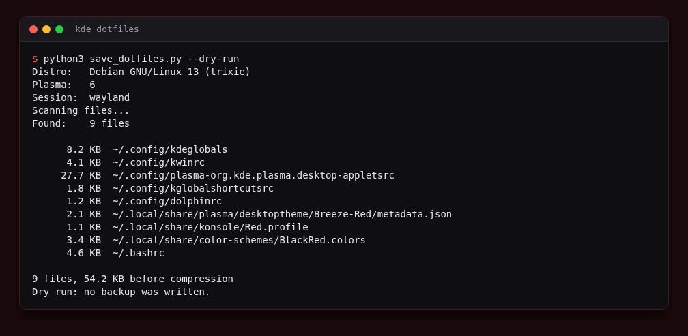

<div align="center">

# KDE Dotfiles

**A pair of Python scripts to back up and restore your KDE Plasma dotfiles - auto-detects distro, Plasma version, and session type.**

[](https://www.python.org/)
[](https://kde.org/)
[](LICENSE)

</div>



---

Two scripts - one saves, one restores. Run the save script on your current machine and it zips everything up. Run the load script on any KDE machine and pick exactly what you want back, category by category.

---

## Requirements

- Python 3.8+
- `tqdm` (`pip install tqdm`)
- KDE Plasma 5 or 6 with `plasmashell` on PATH

---

## Scripts

### KDEdotfilesSAVE/save_dotfiles.py

Detects your distro, Plasma version, and session type, then backs up all KDE config and assets into a timestamped `.zip` next to the script.

**Auto-detects:**

| Thing | How |
|---|---|
| Distro | `/etc/os-release` |
| Plasma version | `plasmashell --version` |
| Session type | `$XDG_SESSION_TYPE` / `$WAYLAND_DISPLAY` / `$DISPLAY` |

Plasma version determines whether `kservices5` or `kservices6` is included. Session type determines whether X11 files (`.Xresources`, `.xprofile`, `.xinitrc`) are included.

**Usage:**

```bash
python3 save_dotfiles.py
```

Output: `kde-dotfiles-YYYY-MM-DD_HH-MM-SS.zip` in the same folder as the script.

`python3 save_dotfiles.py --dry-run` lists every file that would be backed up with its size and the total, without writing a zip.

---

### KDEdotfilesLOAD/load_dotfiles.py

Finds all backups next to the script (or in a sibling `KDEdotfilesSAVE/` folder) and lets you choose which categories to restore. Each prompt is a single keypress - no Enter needed.

**Usage:**

```bash
python3 load_dotfiles.py
```

If more than one backup exists, you pick which one first. Then for each category:

```
What would you like to restore?

  KDE core settings? [y/n]
  Desktop layout? [y/n]
  Keyboard shortcuts? [y/n]
  ...
```

**Preview first:** `python3 load_dotfiles.py --dry-run` asks the same questions, then lists each file as `new`, `overwrite` or `outside home` (unchanged files are counted but not listed) and changes nothing.

```
  overwrite    ~/.config/kwinrc
  new          ~/.config/autostart/app.desktop

1 new, 1 overwrite, 12 unchanged
Dry run: nothing was changed.
```

---

## What Gets Saved

| Category | Paths |
|---|---|
| KDE core settings | `.config/kdeglobals`, `kwinrc`, `kwinrulesrc`, `plasmashellrc`, `ksmserverrc`, `kcminputrc`, `kscreenlockerrc` |
| Desktop layout | `.config/plasma-org.kde.plasma.desktop-appletsrc` |
| Keyboard shortcuts | `.config/kglobalshortcutsrc` |
| App configs | `.config/dolphinrc`, `konsolerc`, `katerc`, `spectaclerc`, `.local/share/konsole/` |
| Autostart | `.config/autostart/` |
| GTK settings | `.config/gtk-3.0/`, `.config/gtk-4.0/` |
| Icon & cursor themes | `.local/share/icons/`, `.icons/` |
| Fonts | `.local/share/fonts/` |
| Wallpapers | `.local/share/wallpapers/` |
| Color schemes | `.local/share/color-schemes/` |
| Window decorations | `.local/share/aurorae/` |
| Plasma themes | `.local/share/plasma/` |
| KWin scripts | `.local/share/kwin/` |
| KDE Connect | `.config/kdeconnect/` |
| Shell dotfiles | `.bashrc`, `.bash_profile`, `.zshrc`, `.profile` (+ X11 files if applicable) |

---

## Tests

```bash
pip install pytest tqdm
python3 -m pytest tests
```

The tests use a temporary home folder, so your real settings are never touched.

---

## Notes

- Skipped files (permission errors) are printed without stopping the run
- After restoring, log out and back in for all changes to take effect
- The load script caps backup selection at 9 entries (single keypress selection)

---

## License

MIT - made by [Drew](https://github.com/drew-codes-things)
